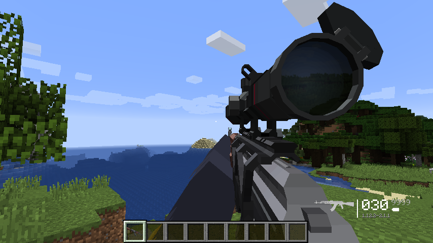
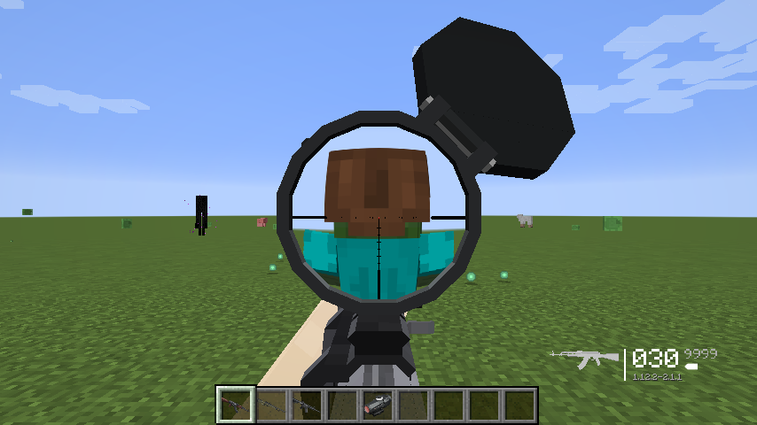
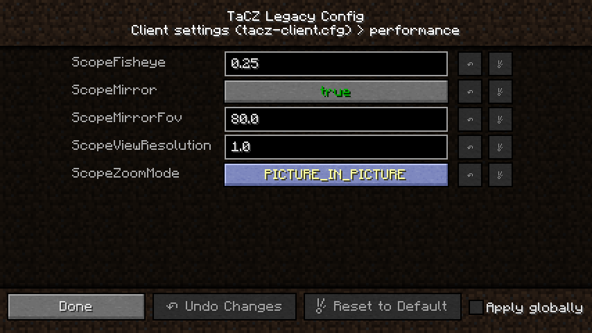

# TaCZ Legacy

An unofficial port of [Timeless and Classics Zero](https://github.com/MCModderAnchor/TACZ) (Forge 1.20.1) to
**Minecraft 1.12.2 Forge**.

The guns themselves are the original ones: this port runs unmodified TACZ gun packs - the same `gunpack` format, the
same Bedrock models, animations and Lua scripts, the same sounds. Guns from those packs work in single player and on
a dedicated server: first-person models and animations, shooting, damage, reloading, scopes, sounds, HUD, gunsmith
table. Tested with the default TACZ pack and with OptiFine (without shaders). It runs on Forge 1.12.2 and needs
[MixinBooter](https://github.com/CleanroomMC/MixinBooter) next to it.

The arsenal itself belongs to [the original mod](https://github.com/MCModderAnchor/TACZ) and is not repeated here.
What follows is what *this port* does differently.

## Scopes

The original zooms the whole screen when you aim through a scope. Here a scope magnifies only what its lens shows.

<table>
  <tr>
    <td width="50%"></td>
    <td width="50%"></td>
  </tr>
  <tr>
    <td><em>from the hip: the lens mirrors what is behind the player</em></td>
    <td><em>aiming: the view through the lens, magnified, with the reticle</em></td>
  </tr>
</table>

- While aiming, the part of the world the lens covers is rendered by a second, small pass with a magnified FOV, with
  the reticle over it and a slight fisheye towards the lens edge; the rest of the screen stays at normal FOV.
- From the hip the lens does not show the world through itself: it mirrors what is behind the player - a faint, dark
  reflection, like the one in a dark window or a switched-off monitor, tinted and wide-angled, like a coated convex
  lens - with no reticle seen behind the glass. The reflection and the reticle fade in as you aim in.

### Prefer the original behaviour?

One switch back, applied without a restart. Open **Mods → Config** (or press **Alt+T**, the open-config key) and edit
*Client settings (tacz-client.cfg) → performance*:

| setting | this port | original behaviour |
|---|---|---|
| `ScopeZoomMode` | `PICTURE_IN_PICTURE` | `FULL_SCREEN_ZOOM` - the whole screen zooms while aiming (also the cheapest option: no second world pass) |
| `ScopeMirror` | `true` | `false` - the lens is see-through from the hip again (and skips the reflection's world pass) |

The same keys live in `config/tacz-client.cfg` under `[performance]`. Other scope knobs in the same section:
`ScopeViewResolution` (resolution of the lens image, lower is faster), `ScopeFisheye` (distortion strength, 0 turns
it off), `ScopeMirrorFov` (how much of the world behind the player the lens mirrors). Under OptiFine shaders scopes
work as in the original automatically.

## Other differences

- **Damage follows real ballistics.** Per-shot damage is derived from the Gosselain number (temporary wound cavity
  volume, proportional to muzzle energy x caliber) compressed by a power law, so big-bore rounds stop being
  exceptions and small high-speed ones are worth their penetration instead of their joules. This is not a pack edit:
  the overrides are applied to the gun data at load time and synced to clients, so the (CC BY-NC-ND) default pack is
  never redistributed in a modified state. `config/tacz-rebalance.cfg` (`enabled = false`, or removing a gun's entry)
  restores the pack values.
- **In-game config GUI.** The Config button of the Mods screen (and Alt+T) opens the three config files - client,
  common and server - with every setting editable in place, applied without a restart.
- **Gunsmith recipes** from gun packs are read as is, but 1.20 tags are turned into OreDictionary entries
  (`forge:ingots/iron` → `ingotIron`). Materials that do not exist in 1.12.2 (copper, amethyst, netherite) are
  unavailable without other mods, so such recipes cannot be crafted.
- **Crawling.** The swimming pose does not exist in 1.12.2, so there is no crawl key of our own. With
  [AquaAcrobatics](https://www.curseforge.com/minecraft/mc-mods/aqua-acrobatics) installed and its
  `Enable Toggle Crawling` option on, its own crawl key makes the player really crawl, and TACZ mirrors that pose
  into the gun state, so the gun animations and the per-weapon crawl rules follow the lying player.
- Sounds "relative to the listener" are played at the player's position.
